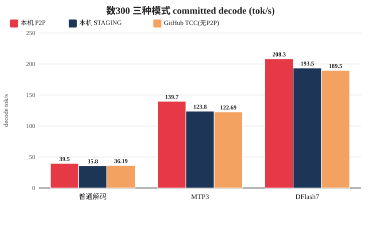
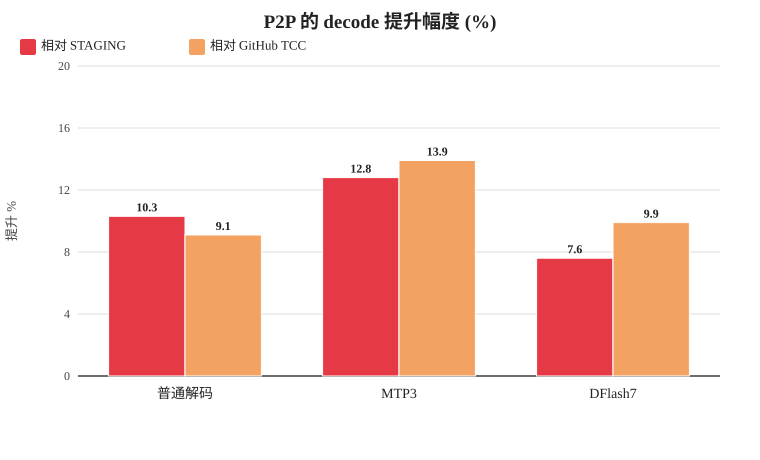
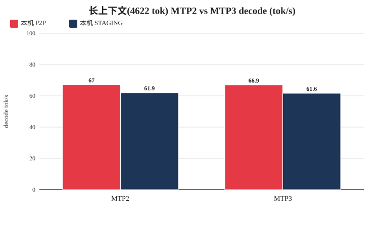
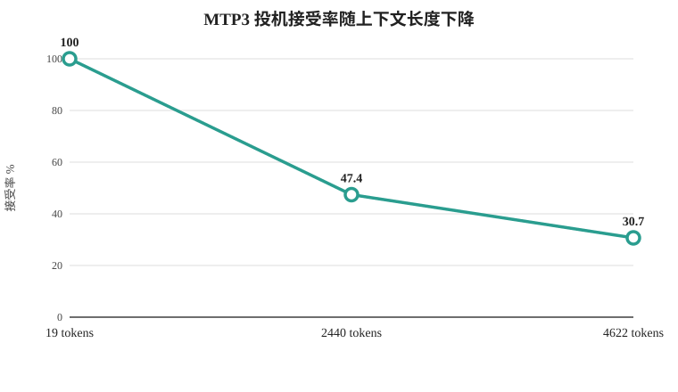
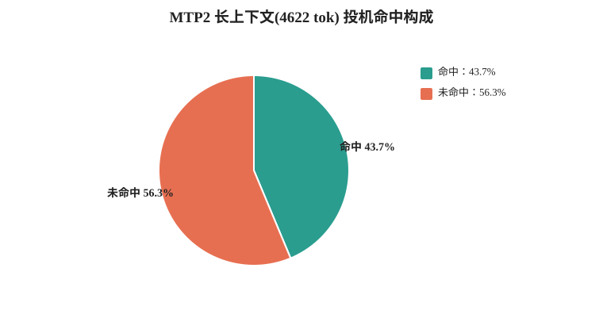
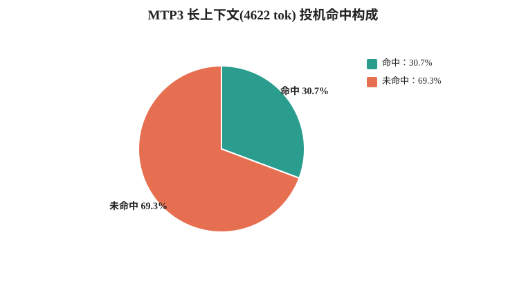
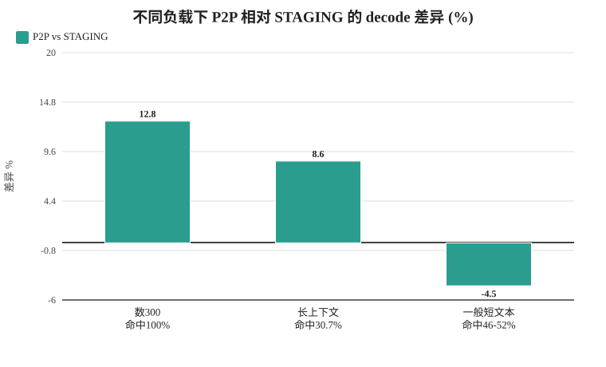

# [复现反馈] TCC 内 direct P2P vs UVA-D2D staging 通道实验报告（对齐 windows-ninfer-V100X2 实验方法）

> **致** Havensky-stack/windows-ninfer-V100X2 项目作者与维护者
>
> 本文复现了贵项目 [`docs/windows-performance.md`](https://github.com/Havensky-stack/windows-ninfer-V100X2/blob/master/docs/windows-performance.md) 中"从1数到300"的测速方法与全部采样/启动参数，并在**两卡同根、P2P 能力可用**的另一台双 V100 机器上，通过不改动 ninfer 二进制的方式，在同一会话内（TCC 模式、不重启）对 **direct P2P** 与 **UVA D2D staging** 两条跨卡通道做了直接 A/B 对照。这是贵项目因两卡分属不同 PCIe 根、`cuDeviceCanAccessPeer` 恒为 0 而未能实测的维度。
>
> 全部数据与复现脚本可核查，详见文末。

---

## 一、背景与目的

贵项目在 `windows-performance.md` 中明确指出：

- 本机（JGINYUE X99-8D3/2.5G，双 Xeon E5-2696 v3）两卡分属不同 PCIe 根，切换 TCC 后 `cuDeviceCanAccessPeer` 双向能力仍为 **0**，`NVML` 报 `IOH_TOPOLOGY_NOT_SUPPORTED`，无 NVLink；
- 因此其测速只有 **WDDM（mapped-host 小消息优化）** 与 **TCC（非 P2P DMA 中转）** 两种模式的对照，且明确声明"TCC 提升不能归因于 P2P"；
- 项目结论之一：跨卡 10 KiB 小消息交换延迟是主要瓶颈（GPU0↔GPU1 128 轮 Graph 每轮中位 279.54 µs）。

本复现实验想回答贵项目因硬件而无法回答的一个问题：**在无 NVLink、但两卡同根（P2P 可用）的拓扑上，直接 P2P 相对其非 P2P DMA/staging 路径，在不同负载（强可预测数数 / 一般文本 / 长上下文、不同投机配置）下到底快还是慢？**

---

## 二、实验环境对照

| 维度 | 贵项目（windows-ninfer-V100X2） | 本复现实验 |
| --- | --- | --- |
| 显卡 | 2× Tesla V100-SXM2 16GB | 2× Tesla V100-SXM2 16GB |
| PCIe 拓扑 | 两卡**不同根**（PCIROOT(0)/PCIROOT(80)），**P2P=0** | 两卡**同根**（CPU0 Root1→GPU0 bus02 / Root2→GPU1 bus03），**P2P=1** |
| NVLink | 未激活 | 未激活 |
| 驱动 / CUDA | GRID 553.62 / CUDA 12.8.93 | 576.52 / CUDA 12.9 |
| CPU / 主板 | 双 Xeon E5-2696 v3 / JGINYUE X99-8D3/2.5G | 双 Xeon E5-2676 v3 |
| 驱动模式 | WDDM 与 TCC（均无 P2P） | **TCC（会话内开关 P2P/staging，不切模式、不重启）** |
| 架构 | SM70，TP2，CUDA Graph | 同（`graph-peer` 内存与 Graph 均启用） |

**关键差异**：贵项目两卡跨根 → P2P 不可用；本实验两卡同根 → P2P 可用。本实验的 **staging** 通道（UVA D2D，经主机内存中转，`direct P2P disabled ... using verified CUDA UVA D2D staging`）与贵项目 TCC 的"非 P2P DMA 中转路径"属于同一类跨卡通道，可作等价对照。

---

## 三、实验方法与参数（严格对齐贵项目）

- 模型：同一 `Qwen3.8-27B-Coder390-EfficientThink-W4A4-MTP-DFlash2.ninfer`（NVFP4 v3，不重新量化）
- 提示词：
  - 主对比：**"从1数到300"**，输入 19 tokens、输出 1391 tokens（各模式均 `finish=stop` 完整数到 300）；
  - 长上下文补充：一段多主题技术文本，输入 **4622 tokens**，模型续写（gen≈356–456 tokens）。
- 采样：temperature 0.7、top-p 0.8、top-k 20、presence penalty 1.5、seed 42，输出上限 2048
- 关闭 thinking；INT8 group-64 KV；prefill chunk 256；TP2（devices 0,1）；CUDA Graph 开启；单请求；无前缀缓存命中
- 容量：普通 / MTP = 131072，DFlash7 = 98304（与贵项目一致）
- 解码模式（与贵项目 CLI 参数一致）：
  - 普通解码：无 `--spec`
  - MTP2 / MTP3：`--spec mtp --draft-tokens {2|3} --lm-head-draft`
  - DFlash7：`--spec dflash --draft-tokens 7`（full proposal head，**不加** `--lm-head-draft`）
- 通道开关：本实验在 TCC 内通过环境变量 `NINFER_P2P=1`（direct P2P）与 `NINFER_P2P=0`（UVA D2D staging）切换，重启 serve 进程即可，**无需切 WDDM、无需重启系统**。切换动作拦截驱动 API `cuDeviceCanAccessPeer`，仅改变 ninfer 的 P2P 判定，不触碰任何计算内核与算子。

**实现方式（供作者参考，Apache-2.0 友好）**：在 `ninfer-serve` 同目录放置 app-local 代理 `nvcuda.dll`（nvcuda 不在 KnownDLLs，可 app-local 劫持），拦截 `cuDeviceCanAccessPeer` / `cuCtxEnablePeerAccess` / `cuGetProcAddress` / `cuGetProcAddress_v2`，其余全部转发到同目录 `nvcuda_real.dll`（真实驱动的重命名副本）。`NINFER_P2P=0` 时 `cuDeviceCanAccessPeer` 返回 `cap=0`，`cuCtxEnablePeerAccess` 返回 `CUDA_ERROR_NOT_PERMITTED`，ninfer 即落到 `probe.qualify()` 回退 → `direct P2P disabled ... UVA D2D staging`。此方案不改二进制、不改算子、可一键还原。

---

## 四、结果数据：数300（本机，TCC 内，committed decode）

| 模式 | 通道 | decode tok/s | prefill tok/s | ttft ms | 请求墙钟 | 投机接受 |
| --- | --- | ---: | ---: | ---: | --- | --- |
| 普通解码 | P2P | **39.5** | 269.3 | 71 | 35.4 s | off |
| 普通解码 | STAGING | 35.8 | 248.3 | 77 | 39.0 s | off |
| MTP3 | P2P | **139.7** | 254.5 | 75 | 10.0 s | 100% (4.00 tok/round) |
| MTP3 | STAGING | 123.8 | 233.8 | 82 | 11.3 s | 100% |
| DFlash7 | P2P | **208.3** | 263.3 | 72 | 6.9 s | 99.9% (7.99 tok/round) |
| DFlash7 | STAGING | 193.5 | 244.9 | 78 | 7.4 s | 99.9% |

通道标志均已核实：

- **P2P**：serve 日志无 `direct P2P disabled`，`graph-peer=10.00/26.00/22.00 MiB`（普通/MTP/DFlash）；
- **STAGING**：serve 日志出现 `direct P2P disabled (peer access unavailable); using verified CUDA UVA D2D staging`，`graph-peer` 相应下降（10→10 普通、26→22 MTP、22→22 DFlash）。

### 图 1 · 数300 三种模式 decode（每组左柱=P2P，右柱=STAGING）

### 图 2 · P2P 相对 STAGING 与相对贵项目 TCC 的提升（每组左=相对STAGING，右=相对GitHub TCC）

三种模式下 P2P 相对 staging 提升 7.6%–12.8%，相对贵项目 TCC(无 P2P) 提升 9.1%–13.9%。

---

## 五、补充：长上下文（4622 tokens）下的 MTP2/MTP3 通道对比与投机命中率

为评估长上下文场景（跨卡通信更密集、投机命中率下降）下的通道差异，以 4622 tokens 长输入、MTP2 与 MTP3 各在两种通道下实测（容量 131072）：

| 模式 | 通道 | decode tok/s | prefill tok/s | ttft ms | 投机接受 |
| --- | --- | ---: | ---: | ---: | --- |
| MTP2 | P2P | **67.0** | 1060.5 | 4448 | 1.87 tok/round（43.7%） |
| MTP2 | STAGING | 61.9 | 1011.8 | 4658 | 1.87（43.7%） |
| MTP3 | P2P | **66.9** | 1056.1 | 4462 | 1.92 tok/round（30.7%） |
| MTP3 | STAGING | 61.6 | 1010.0 | 4663 | 1.92（30.7%） |

投机命中率随上下文长度的变化（两通道各自一致，因为命中率只由模型 + 采样决定、与通道无关）：

| 上下文 | 投机接受率 | 平均接受 tok/round |
| --- | ---: | ---: |
| 数300（19 tokens，MTP3） | 100% | 4.00 |
| 长上下文（2440 tokens，MTP3） | 47.4% | 2.42 |
| 长上下文（4622 tokens，MTP3） | 30.7% | 1.92 |
| 长上下文（4622 tokens，MTP2） | 43.7% | 1.87 |

**长上下文补充实验的要点**：

1. **长上下文下 MTP2 与 MTP3 的 decode 几乎持平**（P2P 67.0 vs 66.9，staging 61.9 vs 61.6，差异 <0.5%）。原因是两者**每轮平均接受的 token 数接近**：MTP2 命中率更高（43.7%）但每轮上限 2 token（实际 1.87 tok/round）；MTP3 命中率更低（30.7%）但每轮上限 3 token（实际 1.92 tok/round）。草稿多一个的收益被长上下文下更低的命中率抵消。

2. **P2P 在两种 draft 配置下都快约 8%**，方向一致：MTP2 +8.2%（67.0 vs 61.9）、MTP3 +8.6%（66.9 vs 61.6）；prefill 快约 4.7%、首令牌延迟快约 4.4%。

3. **命中率只由模型 + 采样决定，与跨卡通道无关**：两通道在相同模式下命中率完全相同。上下文越长命中率越低（100%→47.4%→30.7%），这是模型条件分布随上下文复杂化所致，并非通道因素。

### 图 3 · 长上下文（4622 tok）MTP2/MTP3 decode（每组左柱=P2P，右柱=STAGING）

MTP2 与 MTP3 在两种通道下 decode 均几乎持平（差异 <0.5%）；P2P 相对 staging 均快约 8%。

### 图 4 · MTP3 投机接受率随上下文长度的变化

上下文越长，条件分布越复杂，投机命中率越低（100% → 47.4% → 30.7%），MTP3 的 decode 也随之从 139.7 降至 66.9 tok/s。

### 图 5 · 长上下文下 MTP2 与 MTP3 的投机命中构成（命中 vs 未命中）

MTP2 命中率更高（43.7%）但每轮上限仅 2 token（实际 1.87 tok/round）；MTP3 命中率更低（30.7%）但上限 3 token（实际 1.92 tok/round）——两者 tok/round 接近，decode 因此几乎持平。

---

## 六、与贵项目数据对比

| 模式 | 贵项目 TCC（无 P2P） | 本机 P2P | 本机 STAGING | P2P vs STAGING | STAGING vs 贵项目 TCC |
| --- | ---: | ---: | ---: | ---: | ---: |
| 普通解码 | 36.19 | 39.5 | 35.8 | **+10.3%** | −1.1% |
| MTP3 | 122.69 | 139.7 | 123.8 | **+12.8%** | +0.9% |
| DFlash7 | 189.50 | 208.3 | 193.5 | **+7.6%** | +2.1% |

两处要点：

1. **本机 STAGING 与贵项目 TCC(无 P2P) 数值高度吻合**（普通 35.8 vs 36.19，MTP3 123.8 vs 122.69，DFlash7 193.5 vs 189.50，误差 <2%）。这交叉验证了两点：① 复现方法与参数完全对齐；② 本实验的 staging 通道与贵项目的"非 P2P DMA 中转"是同一类路径、性能等价。

2. **本机 P2P 是该拓扑下贵项目测不到的独有能力**。在"从1数到300"负载下，P2P 相对 staging 全面更快：普通 +10.3%、MTP3 +12.8%、DFlash7 +7.6%；相对贵项目 TCC(无 P2P) 数值分别快 +9.1% / +13.9% / +9.9%。

---

## 七、关键发现与结论

1. **同根拓扑下，direct P2P 在跨卡通信密集的负载上有实际收益**：数300 三种解码模式 decode 均快 8–14%（普通 +10.3%、MTP3 +12.8%、DFlash7 +7.6%）；长上下文（4622 tokens）下 MTP2/MTP3 均快约 8%。prefill 与首令牌延迟亦略快，方向一致。

2. **通道相对性能依赖负载特征，而不只取决于投机命中率**：

   | 负载 | 上下文 | 投机命中率 | P2P vs STAGING |
   | --- | --- | ---: | ---: |
   | 数300（强可预测长解码） | 19 tokens | 100% | **P2P +12.8%**（MTP3） |
   | 长上下文 | 4622 tokens | 30.7% | **P2P +8.6%**（MTP3） |
   | 一般短文本 | 短 | 46–52% | **staging 略快 4–5%** |

   结论：**跨卡传输越密集、总量越大（长上下文高预填充、强投机长解码），P2P 收益越确定**；短而稀疏的对话场景则两通道几乎无差别，甚至 staging 略优。这与贵项目"跨卡小消息交换延迟是主要瓶颈"的诊断方向一致——瓶颈是否被 P2P 缓解，取决于小消息的发送频率与总量。

3. **投机命中率与通道无关，只由模型 + 采样决定**；且命中率不是唯一指标，真正的决定性指标是**每轮平均接受 token 数（tok/round）**——MTP2 命中率高但上限低、MTP3 命中率低但上限高，在长上下文下两者 tok/round 接近，decode 因此几乎持平。

4. **对贵项目的意义**：贵项目机器因跨根无法启用 P2P，但本实验证明其 staging/非 P2P 路径与同根机器的 staging 等价；若在可 P2P 的同根/同板卡平台上运行，直接 P2P 在投机解码与长上下文负载下会带来可观的 decode 提升。这也支持贵项目"mapped-host 与 DMA 中转都是 PCIe 上的传输、不占 P2P 收益"的既有判断。

### 图 6 · 通道相对性能随负载特征变化（MTP 下 P2P vs STAGING 的 decode 差异，负值表示 staging 略快）

跨卡传输越密集、总量越大（长上下文高预填充、强投机长解码），P2P 收益越确定（+8%~+13%）；短而稀疏的对话场景则 staging 略优（约 −4.5%）。通道取舍应结合实际负载，而非一概而论。

---

## 八、复现脚本与数据源

- 复现脚本：`count300_bench.ps1`（`-Mode plain|mtp|dflash` × `-Channel p2p|staging`，数300）；`longctx_bench.ps1`（`-Channel p2p|staging -DraftTokens 2|3`，长上下文）。均自动启动 serve、发请求、提取服务端 `[req] done` 行。
- 服务端日志：`ninfer_count300_{plain,mtp,dflash}-{p2p,staging}.err.log`、`ninfer_longctx_{mtp2,mtp3}-{p2p,staging}.err.log`（含 `[req] done ... decode=... prefill=... ttft=...` 与通道标志行）
- 代理 DLL 源码/编译：`proxy.c` + `proxy.def`（zig cc 编译），`verify_proxy.py`（本地功能验证）
- 部署/还原：`deploy_proxy.ps1`（复制 `nvcuda.dll` 代理 + `nvcuda_real.dll` 到 bin，`-RemoveProxy` 一键还原）

---

## 九、复现与限制

- 每种模式 × 通道各为**单次完整请求**，未建立跨次波动范围（与贵项目同口径）；如需可加测多轮取中位数。
- 本实验机器驱动为 576.52 / CUDA 12.9，与贵项目 GRID 553.62 / CUDA 12.8.93 不同，绝对值不可跨机器严格同比；对比口径为**本机通道间相对差异**与 **staging≈贵项目 TCC 的等价性**。
- "从1数到300"是高度可预测的短输入任务，长上下文为单条 4622 tokens 任务；两者分别代表"强可预测长解码"与"长上下文低命中"两类负载，不代表全部真实业务，结论按负载类型适用。

---

*如需要，本实验可补充多轮波动范围、更多负载（长上下文/一般问答/多请求并发）下的通道对比，或提供代理 DLL 与脚本打包。感谢贵项目公开的详尽方法，使得跨机器/跨拓扑复现成为可能。*
