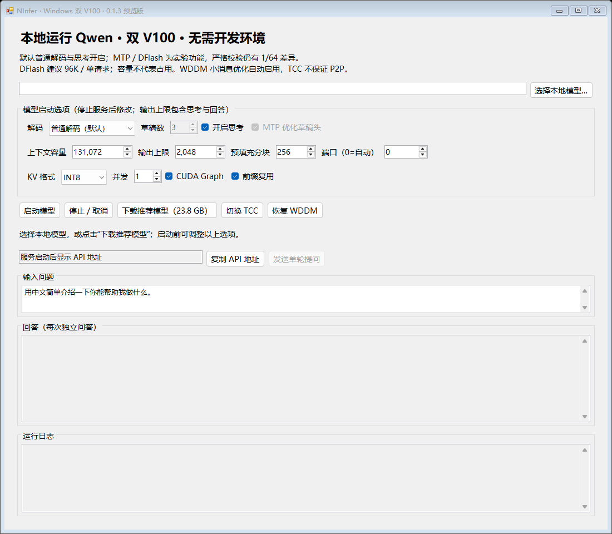

# NInfer Windows 双 V100

[English](README.en.md) · [下载 Windows 应用 v0.1.3](https://github.com/Havensky-stack/windows-ninfer-V100X2/releases/tag/v0.1.3-windows-preview) · [使用与构建详情](docs/windows-toolchain.md)

**让双 Tesla V100 在 Windows 上运行本地 Qwen：中文便携应用、双卡推理优化与兼容 API。**

NInfer Windows 双 V100 面向希望在 Windows 电脑上运行本地大模型的双卡用户，围绕已登记的 Qwen 27B 模型提供原生 C++/CUDA 推理、中文启动器和命令行工具。可以直接进行本地问答，也可通过 OpenAI / Anthropic 兼容 API 接入聊天客户端、代码助手和 Agent 工具；具体协议范围见[服务文档](docs/serving.md)。

项目重点是 **Windows 双卡适配、V100 通信与推理优化，以及便于普通用户使用的发行包**。便携应用提供模型选择与显式下载、启动参数配置和 TCC/WDDM 切换入口；无需安装开发工具链或替换系统 CUDA。支持 GRID/WDDM 游戏配置，也可按需切换 TCC 用于推理。

本仓库现独立维护，代码基于 [tuxKOH/ninfer-V100X2](https://github.com/tuxKOH/ninfer-V100X2) 及相关上游工作，继续保留提交历史、许可证和来源说明。当前为预览版，已验证 Windows 11 + 双 V100-SXM2 16GB + GRID 553.62；MTP/DFlash 仍为实验功能，实测条件与已知限制在下文公开。

## 本项目做了什么

- **原生 Windows CLI/API**：适配文件映射、并发偏移读取、RAM-KV 虚拟内存、网络、控制台和日志，保留上游 Engine/TP2/算子路线。
- **WDDM 小消息通信优化**：无 P2P 的双 V100 使用映射主机内存传输；“从1数到300”的普通解码从 16.49 提高到 28.08 tok/s，答案逐字节一致。条件和限制见[本机性能报告](docs/windows-performance.md)。
- **TCC 实测与模式切换**：同一 GRID 553.62 下，双卡 TCC 的普通解码/MTP3/DFlash7 数数成绩为 36.19/122.69/189.50 tok/s，比优化后的 WDDM 提高约 23%–30%；提供推理用 TCC、游戏恢复 WDDM 的双击脚本。
- **保留现有驱动与环境**：项目内独立 CUDA 12.8.1 + MSVC 14.44 工具链，不替换系统 CUDA 12.4；修复中文 MSVC 头文件依赖检测。
- **接入指定 Coder390 v3 模型**：验证原始权重布局、DFlash 上下文副本和独立聊天模板；不重新量化模型。八组模板输出与原始 Jinja 模板逐字节对照。
- **本机验证与公开限制**：双卡无 P2P/NVLink 的 Graph 探针、九项平台回归、真实 CLI/API 问答、上下文容量检查；明确保留 MTP 尚未通过的严格校验结果。
- **中文便携应用**：显卡检查、模型选择/断点下载/SHA-256 校验、普通/MTP/DFlash 与启动参数配置、思考内容显示、一键启动/停止、TCC/WDDM 切换入口；运行依赖随包提供。

## 上游与工作来源

| 来源 | 本项目继承或参考的工作 |
|---|---|
| [tuxKOH/ninfer-V100X2](https://github.com/tuxKOH/ninfer-V100X2) | **直接上游**：双 V100 执行路线、CUDA 算子、模型运行时、格式及工具。主要推理能力来自这里。 |
| [Neroued/ninfer](https://github.com/Neroued/ninfer) | 原始 NInfer C++/CUDA 推理引擎。 |
| [wamansou/ninfer-tp2-1m](https://github.com/wamansou/ninfer-tp2-1m) | 上游继承的双卡 TP2、跨设备 Graph 和 YaRN 工作。 |
| [geoffwatts/ninfer-v100](https://github.com/geoffwatts/ninfer-v100) | 上游整合的 Volta/V100 实现。 |
| [ww485000/ninfer-windows-v100 · v100-sm70](https://github.com/ww485000/ninfer-windows-v100/tree/v100-sm70) | Windows 平台适配参考，尤其文件映射及偏移 I/O；其单卡 TCC 结果不是本项目的双卡 WDDM 成绩。 |
| [Merkyor 的 NVFP4-NInfer 模型仓库](https://modelscope.cn/models/Merkyor/Qwen3.8-27B-Coder390-EfficientThink-Opus5.5-GPT6Astra-Grok4.7-DSV4Pro-K3-SFT-RLOO-NVFP4-NInfer) | 本次验证的 Coder390 模型与容器来源；本项目不宣称其训练或量化成果。 |

感谢这些项目的工作。代码遵循 [Apache-2.0](LICENSE)，来源说明见 [NOTICE](NOTICE)。第三方组件及模型分别遵循其许可证。

## 本次上游同步

已集成直接上游的 [Volta 优化](https://github.com/tuxKOH/ninfer-V100X2/commit/861633e8) 和
[测试接口修正](https://github.com/tuxKOH/ninfer-V100X2/commit/756d1363)：包括 W8 词表头的加载时精确排列、
NVFP4 投影与 INT8 注意力优化，并保留本项目的 Windows 适配、WDDM 通信路线和中文启动器。
原始模型文件及量化 code/scale 不重新量化。

**0.1.3 本机复测：DFlash7 数数为 189.19 tok/s，旧版为 189.50 tok/s；未测出明显提速，答案逐字节一致。**
新版算子与平台检查通过；投机解码原有的 1/64 严格校验失败仍存在，保持实验状态。

上游同时带来的 PP2、`--volta-long-attention` 和 Q/K 均值检索 RAM-KV 均为实验选项，
默认关闭，未加入启动器。PP2 和实验长注意力不支持 DFlash；RAM-KV 属于近似注意力。
上游 Linux/P2P/QUASAR 成绩不作为本机 Coder390 性能结论；本机测量见[Windows 性能报告](docs/windows-performance.md)。

## 小白使用：下载、解压、双击

1. 安装适合自己显卡的 NVIDIA 驱动。**本机验证的是 GRID 553.62，WDDM 与 TCC 均完成测速**，不是要求所有机器盲目更换到该版本。
2. 从 [v0.1.3 Release](https://github.com/Havensky-stack/windows-ninfer-V100X2/releases/tag/v0.1.3-windows-preview) 下载 `NInfer-Windows-V100X2-0.1.3.zip`，完整解压，双击 **`NInfer.exe`**。不要在压缩包内直接运行。
3. 选择已有的兼容 `.ninfer` 模型；没有模型时点击 **“下载推荐模型”**。模型约 **23.8GB**，需预留至少 25GB 磁盘空间，支持取消后续传及完整性校验。
4. 选择解码模式及启动选项，点击 **“启动模型”**，等待服务就绪。默认普通解码、思考开启、128K 容量；选择 DFlash 会将草稿数设为 7、并发设为 1，并把超过 96K 的容量降到 96K 建议值。显存不足时降低容量。
5. 在界面提问，点击 **“发送单轮提问”**。每次问答独立；多轮聊天可使用自己的 OpenAI API 客户端。
6. 点击 **“停止 / 取消”**或正常关闭窗口，会停止本应用启动的服务并释放显存。

**无需安装 Python、CUDA Toolkit 或 Visual Studio。** CUDA runtime 与 VC++ 运行库随发布包提供，界面使用 Windows 自带的 .NET Framework 4.8。应用不安装驱动、不自动切模式，也不修改全局环境变量或其他服务。只有点击“切换 TCC / 恢复 WDDM”并允许 UAC 后，附带脚本才会请求切换；随后需自行重启。



运行范围：Windows 11 x64，NVIDIA 设备 `0,1` 为两张至少 16GB 的 V100。RX550 可继续负责显示输出。建议 64GB 以上系统内存；本机验证为 128GB，较小内存尚未验证。发布包未做代码签名，请核对同一 Release 的 `SHA256SUMS.txt`。

### 发布应用的启动选项

| 选项 | 默认值与说明 |
|---|---|
| 解码模式 | 普通；可手动启用实验 MTP 或 DFlash。 |
| 草稿数 | MTP 最多 3，DFlash 最多 7；MTP 可开关优化草稿头。 |
| 思考模式 | 默认开启；内置聊天分别显示思考与回答，达到输出上限时提示截断。 |
| 上下文容量 | 默认 131072，输入历史、思考和回答共用；DFlash 建议 98304。 |
| 输出上限 | 默认 2048，包含思考与回答；同时用于 API 默认值和内置聊天。客户端可另行指定。 |
| 预填充分块 | 默认 256，可选 128 的倍数至 1024；更大分块需要更多显存。 |
| KV 格式 | 默认 INT8，可选 BF16；BF16 显存需求更高。 |
| 并发 | 默认 1；普通/MTP 可选 1–8，共享 KV 按容量 × 并发分配，可能被显存预算拒绝；DFlash 固定 1。 |
| CUDA Graph / 前缀复用 | 默认开启，可分别关闭。WDDM 小消息传输优化按硬件自动启用，无需手动开关。 |
| API 端口 | 默认 0 自动选择，也可填 8081 等固定端口；只监听本机。 |
| TCC / WDDM | 点击对应按钮调用附带脚本；运行模型时按钮禁用，先停止模型再切换。 |

模型路径和启动选项自动保存在本地，运行日志显示实际启动命令。修改启动选项需先停止服务。
应用启动时**不会自动下载模型**；点击“下载推荐模型”并选择目录后，才会从 ModelScope 自动下载、断点续传及校验，完成后仍由你点击“启动模型”。

### 连接聊天客户端

启动成功后点击 **“复制 API 地址”**，在客户端选择 OpenAI 兼容接口：

- Base URL：启动器显示的 `http://127.0.0.1:端口/v1`。
- 模型名：`coder390`。
- API key：留空；客户端强制填写时可填 `local`。

服务仅监听本机。端口由启动器自动选择，避免占用已有服务的端口。

### 推荐模型

启动器下载的明确文件是：

`NVFP4-NInfer/W4A4/Qwen3.8-27B-Coder390-EfficientThink-W4A4-MTP-DFlash2.ninfer`

来源为上表 Merkyor 仓库，SHA-256：

```text
3c2d39f364a8932c82b41d4c424c940285573b0309481a67c2fde048368bf808
```

仅支持本项目登记的模型。**不能直接加载普通 GGUF、safetensors 或任意改成 `.ninfer` 后缀的文件。** 不要选该仓库的 `NInferV2-NOT-FOR-V3` 旧包。

## 本机实测与限制

**v0.1.3 发布包已包含 WDDM 通信优化、实验 MTP/DFlash 开关和完整启动选项。** 旧 0.1.0 ZIP 不包含这些更新；下面的速度来自同一推理实现的 CLI/API 对照，不是开启思考后的速度保证。

### 推理速度与并发

以下表格保留 **v0.1.2** 的驱动模式基准；本次上游同步后的 DFlash7 对照见[性能报告](docs/windows-performance.md#上游-volta-更新本机复测)。

2026-10-14，Windows 11、两张 V100-SXM2 16GB、GRID 553.62、CUDA 12.8、SM70、TP2、CUDA Graph。
Coder390 v3 原始权重不重新量化，INT8 group-64 KV，prefill chunk 256，关闭 thinking。
提示词“从1数到300”，实际输入 **19 tokens**、输出 **1391 tokens**；temperature 0.7、top-p 0.8、top-k 20、presence penalty 1.5、seed 42。

| 解码模式 | 优化后 WDDM | TCC | TCC 提升 | TCC 请求耗时 | 上下文容量 |
|---|---:|---:|---:|---:|---:|
| 普通解码（默认） | 28.08 tok/s | **36.19 tok/s** | 28.9% | 38.51 秒 | 131072 |
| MTP3（实验） | 94.68 tok/s | **122.69 tok/s** | 29.6% | 11.44 秒 | 131072 |
| DFlash7（实验） | 153.70 tok/s | **189.50 tok/s** | 23.3% | 7.43 秒 | 98304 |

表中是**已提交 decode 吞吐**，不含加载和 prefill；请求耗时包含 prefill，不含加载。每种模式各测一次，分别与对应 WDDM 输出逐字节一致；MTP 接受 1044/1044 草稿，DFlash 接受 1217/1218。**短输入数数和高接受率不能代表一般问答、85K 占用或满容量性能，也不能证明超过 LM Studio。**

WDDM 的 80 KiB 以内小消息 all-reduce 使用 mapped-host 优化，普通解码由原来的 16.49 提升至 28.08 tok/s，MTP3 由 57.07 提升至 94.68 tok/s。TCC 使用现有非 P2P DMA 中转路径。两种模式均未启用 P2P；TCC 的收益不能归因于 P2P。

并发只在 **WDDM、每路 4096 容量**下完成测量：8 路普通解码合计 **180.23 tok/s**，8 路 MTP3 合计 **207.88 tok/s**（每路约 27.2 tok/s）。合计值包含 prefill/调度，不同于上表 decode 口径。引擎最多 8 个活跃请求，启动器固定单请求；DFlash 的 2/4 路存在形状错误，8 路被显存预算拒绝，尚未修复。详见[完整测试条件、并发结果与限制](docs/windows-performance.md)。

### 上下文与正确性边界

Windows 11、2× V100-SXM2 16GB、GRID 553.62/WDDM、PCIe 3.0 ×16，**无 P2P、无 NVLink**。普通解码、INT8 KV、256-token 预填充分块、单请求、关闭 Vision：

| 上下文容量 | 验证结果 |
|---|---|
| 131,072 | API 问答通过，启动后每卡约剩 1.80 GiB。 |
| 200,000 | CLI 问答通过，每卡约剩 420 MiB，余量较小。 |
| 220,000 | 当前显存预算不足，启动前被拒绝。 |

这是**容量分配加短问答**，不是填满长上下文后的性能或质量证明。游戏及其他 GPU 程序会减少可用显存；容量包含输入历史与输出。

**启动器默认普通解码，不启用 MTP/DFlash。** 两种投机模式的 Graph/eager 对照通过，但严格 teacher-forced argmax 校验均在 64 个位置中有 1 个不同；普通解码对照为 0/64。原失败判据没有放宽，测速成功不等于质量验收通过。Vision、长期满容量运行尚未在此 Windows 预览版完成验收。

上游 Linux 的 QUASAR/MTP/DFlash 速度与其他 GPU 成绩属于[上游项目](https://github.com/tuxKOH/ninfer-V100X2)，**不作为本项目 Windows 性能宣传**。详细验证见 [Windows 指南](docs/windows-toolchain.md)。

## 显卡模式：推理用 TCC，游戏用 WDDM

脚本已随源码提交在 [`tools/windows`](tools/windows)，不需要编译。下载或克隆源码后，保留以下三个文件在同一目录：

| 文件 | 用途 |
|---|---|
| [enable-tcc.cmd](tools/windows/enable-tcc.cmd) | 双击，为两张 V100 请求 TCC 推理模式。 |
| [restore-wddm.cmd](tools/windows/restore-wddm.cmd) | 双击，为两张 V100 请求 WDDM 游戏模式。 |
| [set-v100-mode.ps1](tools/windows/set-v100-mode.ps1) | 共用实现，自动识别恰好两张 Tesla V100，按查询到的 UUID 操作。 |

v0.1.3 ZIP 的 `tools/` 目录也包含这三个脚本，启动器上的切换按钮调用同一实现。

先退出使用 V100 的游戏和推理程序，再双击相应 `.cmd`，允许 Windows UAC 管理员授权。**确认两卡 Pending 均为目标模式后，保存工作并重启**；重启后 Current 应与 Pending 一致。TCC 下 V100 不能承担游戏图形渲染，RX550 可继续输出画面。脚本不强制切换、不自动重启，也不安装驱动或改动其他型号显卡；驱动拒绝或只完成一张时会报错并显示状态，恢复 WDDM 可使用同一恢复入口。

只读查询（无需管理员权限，也不会切换模式）：

```powershell
powershell.exe -NoProfile -ExecutionPolicy Bypass -File .\tools\windows\set-v100-mode.ps1 -Mode Status
```

切换日志保存在 `%LOCALAPPDATA%\NInferV100X2\driver-mode`。模式支持取决于显卡和驱动；本机 GRID 553.62 的 help 支持 `-dm 0/1`，实际完成了 WDDM → TCC 并重启生效，恢复 WDDM 尚未执行复测。

**TCC 不保证开启 P2P。** 本机两卡分属不同 PCIe 根，切换后双向能力仍为 0，NVML 报 `IOH_TOPOLOGY_NOT_SUPPORTED`，NVLink 未激活。固定插槽下不能靠软件开关绕过；继续调查 NVLink 需先核实 SXM2 底板实际互联布线。

## 已有源码和构建产物时如何使用

在仓库根目录的 PowerShell 执行：

```powershell
.\tools\windows\serve.ps1 -Artifact '.\models\Qwen3.8-27B-Coder390-EfficientThink-W4A4-MTP-DFlash2.ninfer' -Context 131072
```

默认监听 `http://127.0.0.1:8080/v1`，用 `-Port` 更换端口。模型 ID 可通过 `/v1/models` 查询。需要自己编译时阅读 [工具链与构建](docs/windows-toolchain.md)；构建便携应用和发布包见 [应用维护说明](docs/windows-app.md)。

日志、模型路径与启动选项保存在 `%LOCALAPPDATA%\NInferV100X2`，设置文件为 `settings.json`。卸载时关闭启动器、删除解压目录即可；模型和设置可自行保留。

### 为什么仓库没有 build-tools？

`.gitignore` 的 `build-*/` 规则会忽略 `build-tools/`。这个目录保存本机下载的 CUDA 组件、编译探针、临时测速脚本及原始日志，由安装/构建流程按需生成，不属于要推送的源码。模型和大型构建产物也不提交；可运行应用从 Releases 下载。

正式维护的 Windows 脚本位于 [`tools/windows`](tools/windows)，测速结论位于 [`docs/windows-performance.md`](docs/windows-performance.md)。显卡切换脚本已从本地临时目录迁到正式目录；克隆仓库即可获得，无需取消整个构建目录的忽略规则。
