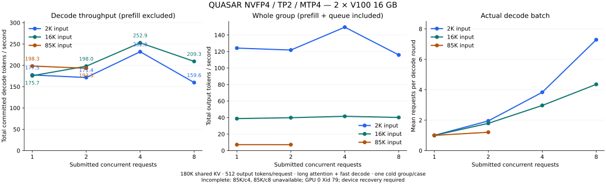

# NInfer V100X2

[English](README.md) · [GUI](docs/gui.md) · [TUI](docs/tui.md) · [详细测评](docs/performance.md) · [HTTP API](docs/serving.md)

**相比 v0.1.0 前的上代解码实现，同一 85K-token 代码任务的已提交 decode 吞吐从 143.46 提升至 198.10 tok/s，约提升 38.1%。**
两次测评均使用双 V100 16 GB、180K 容量、TP2/MTP4、INT8 KV、CUDA Graphs 和 greedy 采样。
本代成绩同时开启实验长注意力与快速数值路径，输出可能变化，当前组合未跑 GPQA。
[本代成绩](docs/performance.md#quasar-v3-mtp4-retained-decode-profile-2026-10-19) · [上代成绩](docs/performance.md#quasar-v3-final-long-context-decode-evaluation)。

面向 **双卡 Tesla V100-SXM2 16 GB** 的 Qwen3.8-27B 单请求推理，CUDA 12.8 / SM70。
本机使用 SXM2 转 PCIe，已启用 PCIe P2P，**没有 NVLink**。
主推 **QUASAR NVFP4 v3**，采用 TP2、INT8 group-64 KV 和 CUDA Graphs。
默认纯文本启动不加载视觉权重；可开启 TP2 图片/视频，复用同一模型文件。GUI/TUI 均提供默认关闭的视觉开关。

维护者个人实际体验是跟 FP8 一档的。作者公布的源模型 GPQA-D 为 90.91%，BF16 为
91.41%；AIME'26 两者均为 100%。这些是外部源模型成绩，不是本机转换后的质量分数，
也不代表数学无损。[公开来源、独立对比和限制](docs/model-quality.md)。

## v0.1.2：视觉长注意力与可选 CPU 视觉塔

- 实验性完整历史长注意力支持 TP2 图片/视频、None/MTP、完整 INT8 KV；快速数值路径仍仅限文本。
- 新增 `--vision --vision-device cpu`，视觉塔只驻主机 RAM、CPU 编码，最后上传 BF16 视觉特征。
  GUI/TUI 可选 GPU/CPU 并保存到配置；显存预估同步区分 CPU 权重和 GPU 特征缓冲。
- CPU 编码在进入 GPU 队列前进行，已有请求可以继续解码；图片/视频首字会更慢。
  CPU/GPU 数值路径和长注意力可能改变输出，未做新 GPQA，不宣称无损。
- 提供可选的 [Linux x86_64 / V100 预编译包](docs/prebuilt.md)和源码包；不含模型、驱动或 Qt。
- [Docker](docs/docker.md) 默认下载 QUASAR v3 后打开 TUI，支持指定其他模型链接。
  QUASAR TP4 的资格验证留给 **0.2.0**。

## v0.1.1：并发、历史分枝缓存与 Responses

实验长注意力现支持 **1–8 个活跃请求**，使用 TP2/MTP4。实际同时执行的请求数仍受共享
KV 容量限制，超出后排队。2K / 16K / 85K 输入矩阵同时报告总解码吞吐与实际批大小。
**已完成 10/12 组**；85K/4 并发时 GPU 0 掉总线（Xid 79），85K/4、8 并发缺测。
本版不宣称相比 v0.1.0 有额外单请求提速。
[测量结果和方法](docs/performance.md#experimental-long-context-concurrency-2026-10-20)。



前缀缓存现保留历史分枝和多棵对话树：`ABD → ABC → ABDE` 可以恢复保存过的 ABD 检查点。
历史 KV 原始字节与完整 GDN/MTP 状态恢复到各请求独占的 GPU pages。
GUI/TUI 可设置 `--prefix-cache-tokens`，默认推荐 **384,000 tokens**，超预算淘汰最旧分枝。
QUASAR INT8 主 KV 加 MTP 在该预算下约占 **12.8 GiB 主机内存**，另有状态与临时所有权；
按 1M tokens 折算约为 33.4 GiB；
归档状态另受 2 GiB 上限限制。设为 0 仅关闭历史保留，仍可复用当前 GPU 前缀。
视觉、DFlash、稀疏 RAM-KV 不使用历史分枝。
[缓存语义与限制](docs/maintainer/paged-kv-cache.md#104-historical-branches)。

Responses 可用 `reasoning: {"effort": "high"}`，按当前 Qwen 模板映射；`none` 关闭思考。
七档入参均通过实际端口的流式/非流式检查。[接口说明](docs/serving.md)。
后续 Release 只提供源码，并记录更新日志及 85K 输入的性能变化。

## QUASAR NVFP4 最新测评 · 2026-10-19

已完成 **80 次速度测量**，覆盖四种文本任务、原生短输入至 **85,000 实际输入 tokens**，
使用下方两份 GUI 保存配置。两份均为 TP2、优化草稿头 **MTP4**、完整 INT8 group-64 KV、
CUDA Graphs、chunk 2560，**快速数值路径均关闭**；无视觉配置开启实验长注意力。

| 实际输入 85,000 tokens | 加载视觉，容量 248,000 | 纯文本，容量 262,144 + 长注意力 |
|---|---:|---:|
| 中文故事 | 86.44 tok/s | 103.43 tok/s |
| 英译中 | 143.57 tok/s | 179.43 tok/s |
| 32 条 JSONL | 185.04 tok/s | **230.40 tok/s** |
| 五槽逻辑题 | 165.22 tok/s | **209.63 tok/s** |

吞吐为**已提交 token 的 decode wall 速度**，不计首个输出和被拒绝的草稿。
两组输入均为文本，加载视觉的一组也不是图片/视频测速。测量时使用 greedy、零惩罚、
关闭前缀复用；排除模型加载、Graph 预热及每个用例的一次完整热启。
原生输入重复两次，其余长度各一次。两份配置同时存在容量、视觉、注意力差异，不能将差值
归因于某一个优化。85K 时平均 prefill 约 1314–1321 tok/s，首字约 64–65 秒。
本轮只测速度，未评分答案，未跑新 GPQA 或其他能力测评。
[全部长度、接受率、输出数与计时](docs/performance.md#quasar-v3-saved-configuration-mtp4-speed-matrix-2026-10-19)。

`--volta-long-attention` 保留全部历史 KV，但改变浮点归约，输出可能变化；
`--volta-fast-decode` 改变 NVFP4/MTP 算术路径。两者均默认关闭，在 GUI/TUI 的实验入口选择，
视觉模式现可使用长注意力，仍不支持快速数值路径。另一份 **85K 实际输入、180K 容量的代码任务**，同时开启两者时测得
**198.105 / 198.097 tok/s**，仍使用 MTP4，当前组合未跑 GPQA。
速度取决于任务与草稿接受率，不能据此宣称通用 200 tok/s。
[数值影响与已保留的解码优化](docs/performance.md#quasar-v3-mtp4-retained-decode-profile-2026-10-19)。

此前的 DFlash7 和 10 月 13 日代码任务成绩保留在
[详细性能文档](docs/performance.md#quasar-v3-final-long-context-decode-evaluation)。

## 全缓存首字延迟

场景为 **300-token prompt、300 tokens 全部命中缓存、实际 prefill 为零**。
现在先发布首个 token，再准备 MTP 桥接/草稿并恢复后续推理所需状态。
使用上方纯文本配置，每条路径测量 15 次、每次输出 64 tokens：

| 缓存路径 | 首字中位数：优化前 → 后 | 降幅 |
|---|---:|---:|
| 原始 tokens，RAM 检查点 | 25.963 → **1.996 ms** | 92.31% |
| Chat，GPU rewrite 检查点 | 5.313 → **2.640 ms** | 50.31% |

计时从公开 `Engine::generate()` 到首次非空流式输出，排除 prompt 准备、HTTP/网络与客户端显示。
这次调整推理调度，没有引入新的数值近似；前后输出、logits、MTP 和状态检查通过。
后续 token 所需工作移到首字发布之后，因此这是 TTFT 改进，不代表 prefill 或持续 decode 同幅加速。
原有长注意力的数值影响仍适用。[测量方法与验证](docs/performance.md#300-token-fully-cached-ttft-2026-10-19)。

## llama.cpp / LM Studio 对比

目前**没有同模型的 QUASAR 与 llama.cpp 对照**。已有历史测试是两边都用 Q4_K_M，
85,000 输入、180,000 请求容量、Q8/INT8 KV、greedy、MTP 最大三最小零，
当时本机尚未开启 PCIe P2P：

| 历史 Q4_K_M 路线 | Decode tok/s | Prefill |
|---|---:|---:|
| NInfer，staging 路线，两次 | 50.68 ± 0.04 | 1251.44 tok/s |
| LM Studio llama.cpp CUDA 2.33.0，一次 | 35.4977 | 185.374 秒 |

它只能作为历史参考，**不能拿来算 QUASAR 的加速倍数**：模型、输出轨迹、通信方式和
重复次数与当前成绩不同；NInfer 计时窗口为 128 tokens，LM 为 512。
早期 512-token 输入的容量测试中，NInfer 约 60 tok/s，
LM Studio 约 62.5–62.8 tok/s。[完整表格与条件](docs/llama-comparison.md)。

## 构建和启动

需要 Linux、NVIDIA 驱动、CUDA 12.8、CMake 3.28+、C++20 编译器、Ninja、
pkg-config、FFmpeg 开发库和 libcurl。系统版本不足时先构建本地依赖：

```bash
bash tools/v100/build_dependencies.sh
PKG_CONFIG_PATH="$PWD/build/_deps/install/lib/pkgconfig${PKG_CONFIG_PATH:+:$PKG_CONFIG_PATH}" \
cmake -S . -B build-v100 -G Ninja -DCMAKE_BUILD_TYPE=Release \
  -DCMAKE_PREFIX_PATH="$PWD/build/_deps/install" \
  -DCMAKE_CUDA_COMPILER=/usr/local/cuda-12.8/bin/nvcc \
  -DCMAKE_CUDA_ARCHITECTURES=70 -DBUILD_TESTING=OFF
cmake --build build-v100 --target ninfer ninfer-serve -j2
```

下载 QUASAR v3，无需本地转换：

```bash
hf download MirkoCovizzi/Qwen3.8-27B-QUASAR-NVFP4-NInfer \
  qwen3_8_27b_nvfp4.ninfer SHA256SUMS \
  --revision v3 --local-dir /Models/ninfer-V100X2/quasar-v3
(cd /Models/ninfer-V100X2/quasar-v3 && sha256sum --check SHA256SUMS)
```

**GUI 控制台**使用 PyQt6 或 PyQt5，安装方式见 [GUI 文档](docs/gui.md#安装)：

```bash
bash tools/v100/ninfer-gui.sh
```

提供每卡显存预估、权重加载进度、日志、指标和命令预览。顶部“配置”支持命名保存/加载、
导入/导出与删除，首次配置库包含两份默认配置：**视觉 / 248000 上下文 / 1024 视觉预算**，
以及**无视觉 / 262144 上下文 / 长注意力**；两份均为 MTP4，快速数值路径关闭。
选择配置后点击“加载”，再核对本机模型与程序路径。内置文件中分别为
`models/quasar-v3/qwen3_8_27b_nvfp4.ninfer` 和 `build-v100/apps/ninfer-serve`，
请将模型路径改为实际下载位置。
KV 默认跟随上下文，展开“独立 KV”后才单独设置；视觉开关在重启服务后生效。
[配置管理与模型路径设置](docs/gui.md)。

也可以用 **TUI 终端启动器**，只需 Python 3.11 标准库：

```bash
bash tools/v100/ninfer-tui.sh
```

选择预设、编辑模型路径/显卡/上下文，查看命令后启动 API。界面显示日志、health 和
Engine 吞吐；`s` 停止自己的服务，`q` 退出。默认 QUASAR MTP4 / 180K，打开 Graph
和前缀缓存；约 198.1 tok/s 的实验组合需要显式选择。TUI 视觉预设为 98K 容量、4096 视觉预算，
复用同一 QUASAR 文件。[完整用法](docs/tui.md)。

直接启动 API：

```bash
env LD_LIBRARY_PATH="$PWD/build/_deps/install/lib:/usr/local/cuda-12.8/lib64${LD_LIBRARY_PATH:+:$LD_LIBRARY_PATH}" \
  build-v100/apps/ninfer-serve /Models/ninfer-V100X2/quasar-v3/qwen3_8_27b_nvfp4.ninfer \
  --host 127.0.0.1 --port 8080 --tp 2 --devices 0,1 --max-concurrency 1 \
  --max-context 180000 --kv-dtype int8 --prefill-chunk 2560 \
  --spec mtp --draft-tokens 4 --lm-head-draft --default-max-tokens 65536 \
  --request-log-jsonl profiles/serve.jsonl --log-stats-interval-ms 1000 --no-thinking
```

DFlash7 改成容量 98304、chunk 1024、`--spec dflash --draft-tokens 7`，去掉
`--lm-head-draft`。输出上限仍受剩余上下文限制。
CLI 用 `build-v100/apps/ninfer`，相同推理参数加 `--prompt TEXT --max-new N`。
多卡主机可用 `--tp 2 --devices 4,6` 选其中两张；设置
`CUDA_VISIBLE_DEVICES=4,6` 后设备会重编号，此时填 `0,1`。
[测试用卡选择](tests/README.md#build-and-run)。

## 专题文档

| 文档 | 内容 |
|---|---|
| [TP4 / NVLink](docs/tp4.md) | 远端四卡、官方 NVFP4/native FP8、API 与 1Cat 对照 |
| [其他 V100 测评](docs/performance-v100.md) | 官方 NVFP4、Q4_K_M、P2P/staging、前缀缓存 |
| [RAM-KV / PP2 实验](docs/experiments.md) | 稀疏检索与启动时固定的分层流水线 |
| [替代模型 / 视觉](docs/alternatives.md) | Q4_K_M 转换、QUASAR 图片/视频入口 |
| [V100 实现说明](docs/v100-implementation.md) | kernel、通信和数值验证细节 |
| [解码源码调研](docs/v100-decode-survey.md) | 已读项目、采用机制和待引入/继续优化候选 |
| [上游继承数据](docs/performance-upstream.md) | 其他硬件、模型、并发和长上下文测评 |
| [文档索引](docs/README.md) | CLI、API、GUI、测试和维护参考 |

主推路线是 **张量并行 TP2**。PP2 是单独的启动时配置，不计入以上 TP2 成绩。

## 致谢与许可

本分支基于 [Neroued/ninfer](https://github.com/Neroued/ninfer)、RTX 3060 TP2 工作和
[geoffwatts/ninfer-v100](https://github.com/geoffwatts/ninfer-v100)，并参考了
[plus1998/Ninfer-V100-Duo](https://github.com/plus1998/Ninfer-V100-Duo) 的 Volta NVFP4 路线。
TP2 BF16 packet-push 通信借鉴 [1CatAI/1Cat-vLLM](https://github.com/1CatAI/1Cat-vLLM)
的双 epoch 机制，其上游注明来自 [haohervchb/sglang-V100](https://github.com/haohervchb/sglang-V100)。
[解码源码调研与接入状态](docs/v100-decode-survey.md)。
DFlash2 参考 [Inco AI](https://inco.ai/blog/dflash2/) 和
[草稿 checkpoint](https://huggingface.co/incoai/Qwen3.8-27B-DFlash2)；
[KVMem](https://github.com/kvmem/kvmem-llama.cpp) 为 RAM-KV 检索提供参考。
[Li3age](https://github.com/Li3age) 在 [PR #1](https://github.com/tuxKOH/ninfer-V100X2/pull/1)
贡献实验 TP2 视觉与可配置视觉预算。

模型来自 [Qwen](https://huggingface.co/Qwen/Qwen3.8-27B)，QUASAR 来自
[QUASAR-QAT](https://huggingface.co/QUASAR-QAT/Qwen3.8-27B-QUASAR-NVFP4)，
NInfer 转换来自 [MirkoCovizzi](https://huggingface.co/MirkoCovizzi/Qwen3.8-27B-QUASAR-NVFP4-NInfer)。
项目使用 [Apache-2.0](LICENSE)，相关声明见 [NOTICE](NOTICE)。
